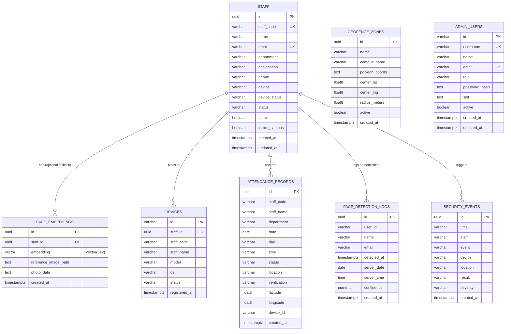

# CampusAttend — API, Native Bridge & Database Reference

**Document Version:** 1.0.0 (Production Verified)  
**Project Name:** CampusAttend — Geofenced Biometric Attendance Management System  
**Repository Path:** `D:\project\geo-fenced-attendence-system`  
**Database Host:** Supabase Managed PostgreSQL (`qvjcxoznvhoagclbyhad.supabase.co`)  
**Serverless API Base URL:** `https://geo-fenced-attendence-system.vercel.app/api`  

---

## Table of Contents
1. [Database Schema Inventory & ERD](#1-database-schema-inventory--erd)
2. [Complete Table-by-Table Schema Specifications](#2-complete-table-by-table-schema-specifications)
3. [Stored Procedures & RPC Functions](#3-stored-procedures--rpc-functions)
4. [Row Level Security (RLS) Policies](#4-row-level-security-rls-policies)
5. [Serverless HTTP API Reference](#5-serverless-http-api-reference)
6. [Native Android JavaScript Bridge Reference](#6-native-android-javascript-bridge-reference)
7. [API-to-Database Operation Mapping Matrix](#7-api-to-database-operation-mapping-matrix)

---

## 1. Database Schema Inventory & ERD

The CampusAttend cloud database is deployed on PostgreSQL 15 via Supabase, utilizing the `uuid-ossp`, `pgcrypto`, and `vector` (pgvector) extensions.



---

## 2. Complete Table-by-Table Schema Specifications

### 2.1 Table: `public.staff`
Stores authoritative profile data, departmental affiliations, and administrative statuses for registered faculty and staff.

| Column Name | Data Type | Constraints | Description |
| :--- | :--- | :--- | :--- |
| `id` | `UUID` | `PRIMARY KEY, DEFAULT gen_random_uuid()` | Internal unique entity identifier |
| `staff_code` | `VARCHAR(64)` | `UNIQUE, NOT NULL` | Human-readable staff code (e.g., `PERSON_001`, `SCT-2417`) |
| `name` | `VARCHAR(255)` | `NOT NULL` | Full legal name of the faculty/staff member |
| `email` | `VARCHAR(255)` | `UNIQUE, NOT NULL` | Official institutional email address |
| `department` | `VARCHAR(255)` | `NOT NULL` | Academic or administrative department |
| `designation` | `VARCHAR(255)` | `NOT NULL` | Official academic title (e.g., Associate Professor) |
| `phone` | `VARCHAR(32)` | `DEFAULT ''` | Contact telephone number |
| `device` | `VARCHAR(255)` | `DEFAULT ''` | Description of registered hardware (e.g., Redmi Note 13 Pro) |
| `device_status`| `VARCHAR(32)` | `DEFAULT 'Active', CHECK IN ('Active', 'Pending', 'Blocked')` | Operational state of the bound handset |
| `status` | `VARCHAR(32)` | `DEFAULT 'Active', CHECK IN ('Active', 'Inactive')` | Employment/enrollment status |
| `active` | `BOOLEAN` | `DEFAULT true, NOT NULL` | Binary authorization toggle |
| `inside_campus`| `BOOLEAN` | `DEFAULT false, NOT NULL` | Last known real-time geofence presence flag |
| `created_at` | `TIMESTAMPTZ`| `DEFAULT NOW(), NOT NULL` | Record creation timestamp |
| `updated_at` | `TIMESTAMPTZ`| `DEFAULT NOW(), NOT NULL` | Last profile update timestamp |

**Indexes:**
- `idx_staff_staff_code` ON `staff(staff_code)`
- `idx_staff_email` ON `staff(email)`
- `idx_staff_active` ON `staff(active)`

---

### 2.2 Table: `public.attendance_records`
Immutable ledger recording all confirmed physical attendance punches. Records are created only after passing all 3 factors (Wi-Fi, GPS polygon, Biometrics).

| Column Name | Data Type | Constraints | Description |
| :--- | :--- | :--- | :--- |
| `id` | `UUID` | `PRIMARY KEY, DEFAULT gen_random_uuid()` | Unique punch transaction identifier |
| `staff_code` | `VARCHAR(64)` | `NOT NULL` | Foreign staff code of attendee |
| `staff_name` | `VARCHAR(255)`| `NOT NULL` | Name of attendee at time of punch |
| `department` | `VARCHAR(255)`| `NOT NULL` | Department affiliation |
| `date` | `DATE` | `DEFAULT CURRENT_DATE, NOT NULL` | Calendar date (IST YYYY-MM-DD) |
| `day` | `VARCHAR(32)` | `NOT NULL` | Day of week (e.g., Friday) |
| `time` | `VARCHAR(32)` | `NOT NULL` | Punch timestamp (e.g., 09:14 AM) |
| `status` | `VARCHAR(32)` | `DEFAULT 'Present', CHECK IN ('Present', 'Late', 'Absent')` | Attendance evaluation result |
| `location` | `VARCHAR(255)`| `DEFAULT 'Main Campus'` | Descriptive verified campus zone |
| `verification`| `VARCHAR(32)` | `DEFAULT 'Verified', CHECK IN ('Verified', 'Failed', 'Manual')` | Verification pipeline classification |
| `latitude` | `DOUBLE PRECISION`| `NULL` | Filtered GPS latitude recorded at punch |
| `longitude`| `DOUBLE PRECISION`| `NULL` | Filtered GPS longitude recorded at punch |
| `device_id`| `VARCHAR(64)` | `NULL` | Bound hardware device identifier |
| `created_at`| `TIMESTAMPTZ`| `DEFAULT NOW(), NOT NULL` | Server transaction timestamp |

**Indexes:**
- `idx_attendance_staff_code` ON `attendance_records(staff_code)`
- `idx_attendance_date` ON `attendance_records(date DESC)`

---

### 2.3 Table: `public.security_events`
Immutable security and administrative audit log tracking anomalous events, authentication rejections, geofence violations, and face re-enrollment approval tokens.

| Column Name | Data Type | Constraints | Description |
| :--- | :--- | :--- | :--- |
| `id` | `UUID` | `PRIMARY KEY, DEFAULT gen_random_uuid()` | Audit event identifier |
| `time` | `VARCHAR(64)` | `NOT NULL` | ISO or formatted event time |
| `staff` | `VARCHAR(255)`| `NOT NULL` | Staff code or 'Unknown / Unauthorized' |
| `event` | `VARCHAR(255)`| `NOT NULL` | Event description (e.g., 'Face Re-enrollment Requested', 'Replay Attack Blocked') |
| `device` | `VARCHAR(255)`| `NOT NULL` | Device model, hardware ID, or approval token payload (`token:XYZ\|status:consumed`) |
| `location` | `VARCHAR(255)`| `NOT NULL` | Location description or GPS coordinates |
| `result` | `VARCHAR(32)` | `DEFAULT 'Blocked', CHECK IN ('Blocked', 'Allowed', 'Flagged')` | Security gate action taken |
| `severity` | `VARCHAR(32)` | `DEFAULT 'Medium', CHECK IN ('Low', 'Medium', 'High')` | Threat severity classification |
| `created_at`| `TIMESTAMPTZ`| `DEFAULT NOW(), NOT NULL` | Audit log timestamp |

**Indexes:**
- `idx_security_events_created_at` ON `security_events(created_at DESC)`

---

### 2.4 Table: `public.geofence_zones`
Defines authorized physical campus polygons and centroid boundaries.

| Column Name | Data Type | Constraints | Description |
| :--- | :--- | :--- | :--- |
| `id` | `UUID` | `PRIMARY KEY, DEFAULT gen_random_uuid()` | Zone identifier |
| `name` | `VARCHAR(255)`| `NOT NULL` | Descriptive name (e.g., 'Main Campus') |
| `campus_name` | `VARCHAR(255)`| `DEFAULT 'Sona College of Technology'` | Academic institution name |
| `polygon_coords` | `TEXT` | `NOT NULL` | JSON string of 19 latitude-longitude coordinate pairs `[[lat, lng], ...]` |
| `center_lat` | `DOUBLE PRECISION`| `DEFAULT 11.6814` | Centroid latitude for distance calculation |
| `center_lng` | `DOUBLE PRECISION`| `DEFAULT 78.1384` | Centroid longitude for distance calculation |
| `radius_meters` | `DOUBLE PRECISION`| `DEFAULT 500` | Fallback radius in meters |
| `active` | `BOOLEAN` | `DEFAULT true, NOT NULL` | Active zone indicator |
| `created_at` | `TIMESTAMPTZ`| `DEFAULT NOW(), NOT NULL` | Zone creation timestamp |

---

### 2.5 Table: `public.admin_users`
Stores credentials and authorization privileges for system administrators.

| Column Name | Data Type | Constraints | Description |
| :--- | :--- | :--- | :--- |
| `id` | `VARCHAR(64)` | `PRIMARY KEY` | Admin user identifier |
| `username` | `VARCHAR(64)` | `UNIQUE, NOT NULL` | Login username |
| `name` | `VARCHAR(255)`| `NOT NULL` | Full name of administrator |
| `email` | `VARCHAR(255)`| `UNIQUE, NOT NULL` | Institutional email |
| `role` | `VARCHAR(32)` | `DEFAULT 'admin', NOT NULL` | RBAC role (`admin`, `super_admin`) |
| `password_hash`| `TEXT` | `NOT NULL` | Salted SHA-256 / PBKDF2 hash of password |
| `salt` | `TEXT` | `NOT NULL` | Cryptographic per-user salt |
| `active` | `BOOLEAN` | `DEFAULT true, NOT NULL` | Account active toggle |
| `created_at` | `TIMESTAMPTZ`| `DEFAULT NOW(), NOT NULL` | Registration timestamp |
| `updated_at` | `TIMESTAMPTZ`| `DEFAULT NOW(), NOT NULL` | Last update timestamp |

**Indexes:**
- `idx_admin_users_username` ON `admin_users(username)`

---

### 2.6 Table: `public.devices`
Hardware-bound registry mapping mobile phones to staff accounts.

| Column Name | Data Type | Constraints | Description |
| :--- | :--- | :--- | :--- |
| `id` | `VARCHAR(64)` | `PRIMARY KEY` | Hardware-bound device identifier (`DEV-8842-AX` or Android ID) |
| `staff_id` | `UUID` | `REFERENCES public.staff(id) ON DELETE SET NULL` | Bound staff foreign key |
| `staff_code` | `VARCHAR(64)` | `NULL` | Bound staff code |
| `staff_name` | `VARCHAR(255)`| `NULL` | Bound staff name |
| `model` | `VARCHAR(255)`| `NOT NULL` | Device hardware model (e.g., 'Redmi Note 13 Pro') |
| `os` | `VARCHAR(64)` | `NOT NULL` | Operating system and API level |
| `status` | `VARCHAR(32)` | `DEFAULT 'Active', CHECK IN ('Active', 'Pending', 'Blocked')` | Device trust status |
| `registered_at` | `TIMESTAMPTZ`| `DEFAULT NOW(), NOT NULL` | Initial binding timestamp |

---

### 2.7 Table: `public.face_embeddings` *(Optional Server Fallback)*
Database schema supporting optional server-side vector similarity search via `pgvector`. In the primary production architecture, templates remain exclusively on client Android hardware.

| Column Name | Data Type | Constraints | Description |
| :--- | :--- | :--- | :--- |
| `id` | `UUID` | `PRIMARY KEY, DEFAULT gen_random_uuid()` | Vector record identifier |
| `staff_id` | `UUID` | `NOT NULL, REFERENCES public.staff(id) ON DELETE CASCADE` | Associated staff member |
| `embedding` | `vector(512)` | `NOT NULL` | 512-dimensional floating-point ArcFace feature vector |
| `reference_image_path` | `TEXT` | `NOT NULL` | Local filename or identifier |
| `photo_data` | `TEXT` | `NULL` | Optional base64 snapshot data URL |
| `created_at` | `TIMESTAMPTZ`| `DEFAULT NOW(), NOT NULL` | Embedding insertion timestamp |

**Indexes:**
- `idx_face_embeddings_staff_id` ON `face_embeddings(staff_id)`

---

### 2.8 Table: `public.face_detection_logs`
High-volume audit stream recording every face recognition attempt.

| Column Name | Data Type | Constraints | Description |
| :--- | :--- | :--- | :--- |
| `id` | `UUID` | `PRIMARY KEY, DEFAULT gen_random_uuid()` | Log entry identifier |
| `user_id` | `VARCHAR(64)` | `NOT NULL` | Identified or attempted staff code |
| `name` | `VARCHAR(255)`| `NOT NULL` | Staff name |
| `email` | `VARCHAR(255)`| `NOT NULL` | Staff email |
| `detected_at` | `TIMESTAMPTZ`| `DEFAULT NOW(), NOT NULL` | Detection timestamp |
| `server_date` | `DATE` | `DEFAULT CURRENT_DATE, NOT NULL`| Calendar date |
| `server_time` | `TIME` | `DEFAULT CURRENT_TIME, NOT NULL`| Local time |
| `confidence` | `NUMERIC(5, 4)` | `DEFAULT 1.0` | Detection confidence score |
| `created_at` | `TIMESTAMPTZ`| `DEFAULT NOW(), NOT NULL` | Ingestion timestamp |

---

## 3. Stored Procedures & RPC Functions

### 3.1 `atomic_consume_face_approval_token`
**Source:** `supabase/migrations/20261010_atomic_replace_face_biometrics.sql`  
**Security:** `SECURITY DEFINER`, `SET search_path = public, pg_catalog, extensions`  
**Permissions:** Granted exclusively to `service_role`; revoked from `PUBLIC`, `anon`, `authenticated`.

```sql
CREATE OR REPLACE FUNCTION public.atomic_consume_face_approval_token(
    p_staff_code VARCHAR,
    p_token VARCHAR,
    p_device_id VARCHAR DEFAULT NULL
)
RETURNS JSONB
```

**Operational Behavior:**
1. Validates `p_staff_code` and `p_token`.
2. Verifies active staff membership in `public.staff`.
3. Acquires a pessimistic row-level lock (`SELECT ... FOR UPDATE`) on the matching approval record in `public.security_events`. Concurrent execution requests on the identical token wait for the lock, observe `status:consumed`, and terminate with `INVALID_OR_CONSUMED_TOKEN`.
4. Extracts `expires_at` timestamp from the token record using regular expression `expires_at:([^|\s]+)`. If missing or malformed, rejects with `MALFORMED_EXPIRY` (Strict fail-closed security).
5. Checks `NOW() > expires_at`. If expired (>24 hours), rejects with `EXPIRED_APPROVAL_TOKEN`.
6. Consumes the token by atomically updating the record to:
   `device = 'token:' || p_token || '|status:consumed|device_id:' || clean_device_id || '|consumed_at:' || now_iso`.
7. Inserts an immutable security audit event into `public.security_events` logging the successful replacement.
8. Returns `{"success": true, "code": "TOKEN_CONSUMED", "message": "Face replacement authorization token successfully consumed."}`.

---

### 3.2 `match_face_embeddings`
**Source:** `supabase/schema.sql` (Lines 234–266)  
**Language:** PL/pgSQL  

```sql
CREATE OR REPLACE FUNCTION match_face_embeddings(
    query_embedding vector(512),
    match_threshold float DEFAULT 0.65,
    match_count int DEFAULT 5
)
RETURNS TABLE (
    id UUID,
    staff_id UUID,
    staff_code VARCHAR,
    name VARCHAR,
    reference_image_path TEXT,
    photo_data TEXT,
    distance float
)
```
Executes an index-assisted nearest-neighbor search using the Euclidean L2 distance operator (`fe.embedding <-> query_embedding`) filtering on `s.active = true` and `distance <= match_threshold`.

---

## 4. Row Level Security (RLS) Policies

All tables in the `public` schema have RLS enabled:

| Table | Policy Name | Command | Expression / Role Restrictions |
| :--- | :--- | :--- | :--- |
| `admin_users` | `Restrict public read admin_users` | `SELECT` | `USING (false)` — **Zero Public Exposure**. Password hashes cannot be queried via anonymous Supabase client. |
| `staff` | `Allow public read staff` | `SELECT` | `USING (true)` — Anonymous clients can view staff directory. |
| `staff` | `Allow public write staff` | `ALL` | `USING (true)` — Used during registration & profile sync. |
| `attendance_records` | `Allow public read attendance_records` | `SELECT` | `USING (true)` — Staff and admin dashboard history queries. |
| `attendance_records` | `Allow public write attendance_records` | `ALL` | `USING (true)` — Serverless attendance insertion. |
| `security_events` | `Allow public read security_events` | `SELECT` | `USING (true)` — Admin audit log viewer. |
| `security_events` | `Allow public write security_events` | `ALL` | `USING (true)` — Security and anomaly logging. |
| `geofence_zones` | `Allow public read geofence_zones` | `SELECT` | `USING (true)` — Client geofence boundary loading. |
| `geofence_zones` | `Allow public write geofence_zones` | `ALL` | `USING (true)` — Admin polygon editor. |

---

## 5. Serverless HTTP API Reference

### 5.1 `POST /api/attendance`
**Purpose:** Primary authoritative attendance recording endpoint. Evaluates all 3 presence factors and writes attendance punch to database.  
**Source:** `api/attendance.ts` (1223 lines)  
**Authentication:** Required. Bearer token in `Authorization` header, or custom header `x-staff-token`, or cookie `staff_session`.

#### Request Headers:
```http
POST /api/attendance HTTP/1.1
Host: geo-fenced-attendence-system.vercel.app
Content-Type: application/json
Authorization: Bearer <STAFF_SESSION_HMAC_TOKEN>
x-client-ip: <EGRESS_IP>
```

#### Request Body Schema (JSON):
```json
{
  "staffCode": "PERSON_001",
  "staffName": "Dr. Priya Ramanathan",
  "department": "Computer Science & Engineering",
  "date": "2026-10-17",
  "time": "09:30 AM",
  "latitude": 11.6775,
  "longitude": 78.1252,
  "accuracy": 12.5,
  "verification": "Verified",
  "distance": 0.2104,
  "confidence": 0.985,
  "antiSpoofScore": 0.9991,
  "attemptNonce": "3ad25ff7-b146-458a-bb36-a4c3defe0a71",
  "networkAuthToken": "<HMAC_TOKEN_OR_NULL>",
  "biometricAttestation": "Device-Local (Android Keystore)"
}
```

#### Server-Side Validation Pipeline:
1. **Staff Token Authentication:** Verifies HMAC-SHA256 signature using `STAFF_TOKEN_SECRET` with `crypto.timingSafeEqual`. Validates `expiresAt`.
2. **Network Egress Gate:** Checks if caller's IP matches `VERIFIED_SONA_EGRESS_IPS` (`111.92.42.18`, `115.247.87.98`) OR validates unexpired `networkAuthToken` minted by campus Wi-Fi verification.
3. **Geofence Boundary Gate:** Executes `isPointInPolygon` on submitted `(latitude, longitude)` against the 19-point Sona College polygon. Rejects if outside campus or accuracy > 50m.
4. **Duplicate Attendance Check:** Queries `attendance_records` for identical `staff_code` and `date`. Rejects with HTTP 409 if punch already recorded.
5. **Biometric Evidence Validation:** Validates `distance <= 0.45`, `antiSpoofScore >= 0.70`, and presence of valid `attemptNonce`.
6. **Database Transaction:** Inserts verified record into `public.attendance_records` and logs event to `public.security_events`.

#### Response (Success — HTTP 201 Created):
```json
{
  "success": true,
  "record": {
    "id": "e4b2d189-9a2c-473d-8812-7934e6b219f8",
    "staff_code": "PERSON_001",
    "staff_name": "Dr. Priya Ramanathan",
    "date": "2026-10-17",
    "time": "09:30 AM",
    "status": "Present",
    "verification": "Verified"
  },
  "message": "Attendance recorded successfully."
}
```

#### Error Status Codes:
- `401 Unauthorized`: Missing or invalid staff session token.
- `403 Forbidden`: Wi-Fi egress check failed or GPS coordinate outside campus boundary.
- `409 Conflict`: Attendance already marked for this staff member today.
- `422 Unprocessable Entity`: Biometric distance exceeds 0.45 or PAD failed.
- `503 Service Unavailable`: Database transaction or insertion failed.

---

### 5.2 `GET /api/network-info` & `GET /api/wifi-status`
**Purpose:** Inspects caller's public IP address, compares against authorized campus egress gateways, and mints short-lived HMAC `networkAuthToken`.  
**Source:** `api/network-info.ts`, `api/wifi-status.ts`  
**Authentication:** Public / Anonymous.

#### Response Schema (JSON):
```json
{
  "isSonaWifi": true,
  "authorized": true,
  "network": "SONA-WIFI",
  "clientIp": "111.92.42.18",
  "verifiedIp": "111.92.42.18",
  "verificationMethod": "SERVER_EGRESS_IP",
  "networkAuthToken": "eyJhbGciOiJIUzI1NiJ9.eyJpcCI6IjExMS45Mi40Mi4xOCIsImV4cCI6MTgwMDAwMDAwMH0.SIGNATURE",
  "timestamp": "2026-10-17T09:30:00.000Z"
}
```

---

### 5.3 `POST /api/admin/login`
**Purpose:** Authenticates administrative credentials and mints signed admin session cookie and JWT.  
**Source:** `api/admin/login.ts`  
**Authentication:** Username and password.

#### Request Schema:
```json
{
  "username": "admin",
  "password": "AuthoritativePassword123"
}
```

#### Response (Success — HTTP 200 OK):
```json
{
  "success": true,
  "token": "ADMIN_SESSION_TOKEN_STRING",
  "admin": {
    "id": "adm_001",
    "username": "admin",
    "name": "Campus Administrator",
    "role": "admin"
  }
}
```
*Sets `admin_session` HTTP-only, SameSite=Strict cookie.*

---

### 5.4 `GET /api/admin/face-requests` & `POST /api/admin/face-requests`
**Purpose:** Lists pending staff face re-enrollment requests and issues 24-hour cryptographic approval tokens.  
**Source:** `api/admin/face-requests/index.ts`  
**Authentication:** Admin token required (`x-admin-token` or cookie).

#### POST Action Schema (Approve Request):
```json
{
  "action": "approve",
  "requestId": "req_uuid_12345"
}
```

#### Response:
```json
{
  "success": true,
  "token": "7f8a9b0c1d2e3f4a5b6c7d8e9f0a1b2c3d4e5f6a7b8c9d0e1f2a3b4c5d6e7f8a",
  "expiresAt": "2026-10-18T09:30:00.000Z",
  "message": "Face change request approved. Valid for 24 hours."
}
```

---

## 6. Native Android JavaScript Bridge Reference

**Interface Name:** `window.AndroidBiometricBridge`  
**Host Application:** `com.campusattend.biometric`  
**Kotlin Source:** `android/app/.../bridge/AndroidBiometricBridge.kt`  
**Client Wrapper:** `src/lib/native-biometric-bridge.ts`  

All methods return serialized JSON strings to ensure type safety and prevent prototype manipulation across the WebView boundary.

### Method Specifications:

#### 1. `isAvailable(): boolean`
Returns `true` when running inside the compiled Android application with initialized Keystore. Returns `false` in standard mobile browsers.

#### 2. `getDeviceId(): string`
Returns the hardware-bound Android device identifier (`Settings.Secure.ANDROID_ID`).

#### 3. `getEnrollmentStatus(staffId: string): string`
Returns JSON string representing enrollment state:
```json
{
  "isAvailable": true,
  "isEnrolled": true,
  "count": 5,
  "staffId": "PERSON_001",
  "deviceId": "b4a8e2f190c3d5e7",
  "isDeviceBound": true,
  "hardwareKeystore": true,
  "templateVersion": 1,
  "hasStagedReplacement": false
}
```

#### 4. `enrollFace(staffId: string, embeddingsJson: string): string`
Encrypts and saves 5 initial biometric template slots using the Android Keystore master key with AAD `"$staffId:$deviceId"`.
- **Inputs:** `staffId` (String), `embeddingsJson` (JSON array of 5 arrays of 512 floats).
- **Output:** `{"success": true, "count": 5, "templateVersion": 1}`.

#### 5. `verifyFace(staffId: string, liveEmbeddingJson: string): string`
Decrypts stored templates and computes cosine distance against the provided live embedding.
- **Inputs:** `staffId` (String), `liveEmbeddingJson` (JSON array of 512 floats).
- **Output:**
```json
{
  "matched": true,
  "staffId": "PERSON_001",
  "distance": 0.2104,
  "threshold": 0.45,
  "activeTemplateCount": 5,
  "validDecryptions": 5,
  "bestIndex": 2,
  "biometricAttestation": "HMAC_ATTESTATION_TOKEN"
}
```

#### 6. `stageReplacement(staffId: string, embeddingsJson: string): string`
Encrypts new templates into an isolated staging buffer without altering active templates.

#### 7. `commitReplacement(staffId: string): string`
Promotes staged templates to active status (incrementing `templateVersion`) and securely deletes old templates.

---

## 7. API-to-Database Operation Mapping Matrix

| User Action | Frontend Component | API / Native Bridge Call | Supabase / PostgreSQL Operation |
| :--- | :--- | :--- | :--- |
| **Mark Attendance** | `mark-attendance.tsx`<br>`FaceScanDialog.tsx` | `POST /api/attendance` | 1. `SELECT` check duplicate in `attendance_records`<br>2. `INSERT INTO attendance_records`<br>3. `INSERT INTO security_events` |
| **Initial Face Enrollment** | `face-enrollment.tsx` | `AndroidBiometricBridge.enrollFace` | Encrypted locally in SQLCipher on device; zero remote server DB calls. |
| **Submit Face Change Request**| `face-enrollment.tsx` | `POST /api/staff/face` | `INSERT INTO security_events (event: 'Face Re-enrollment Requested')` |
| **Admin Approves Request** | `admin.face-requests.tsx` | `POST /api/admin/face-requests` | `UPDATE security_events SET device = 'token:XYZ\|status:approved'` |
| **Commit Face Replacement** | `face-enrollment.tsx` | `POST /api/staff/face` | `SELECT public.atomic_consume_face_approval_token(...)` (`FOR UPDATE` lock) |
| **Admin Login** | `index.tsx` (Admin dialog) | `POST /api/admin/login` | `SELECT * FROM admin_users WHERE username = $1` |
| **View Audit Trail** | `admin.audit-logs.tsx` | `GET /api/admin/audit-logs` | `SELECT * FROM security_events ORDER BY created_at DESC LIMIT 100` |
| **Live Geofence Boundary Edit**| `admin.campus-map.tsx` | Direct Supabase Client | `UPDATE geofence_zones SET polygon_coords = $1 WHERE name = 'Main Campus'` |
