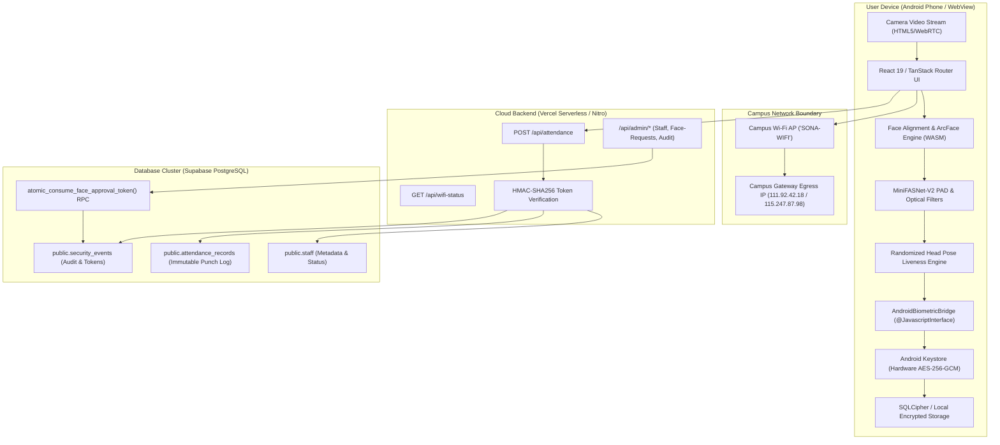
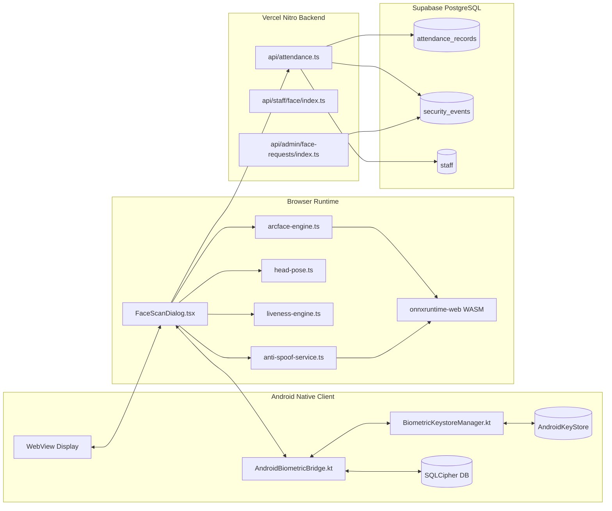
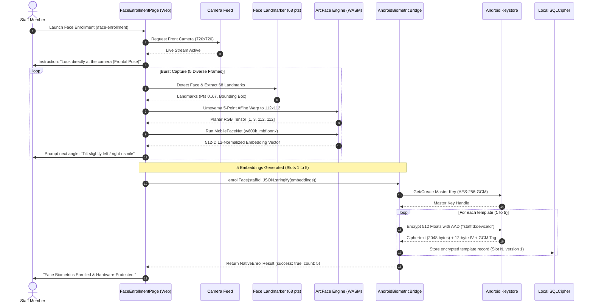
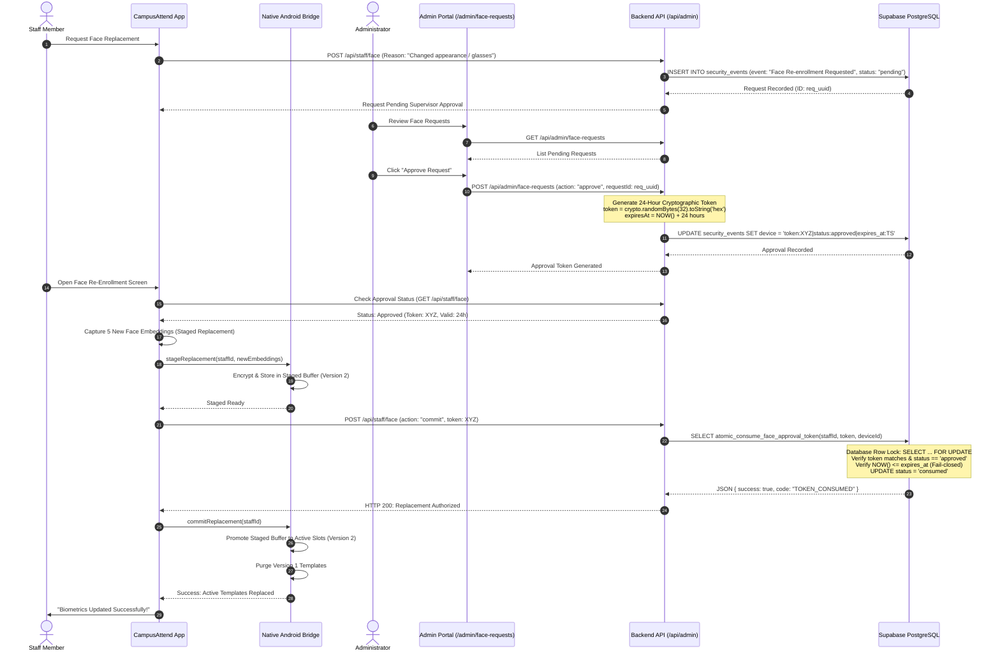
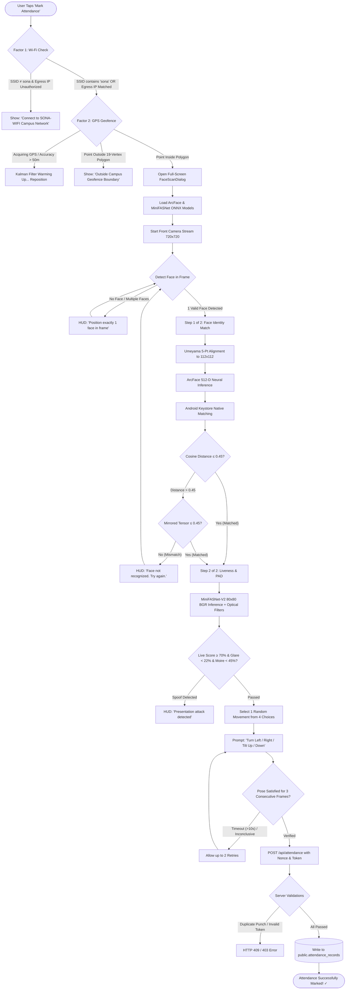
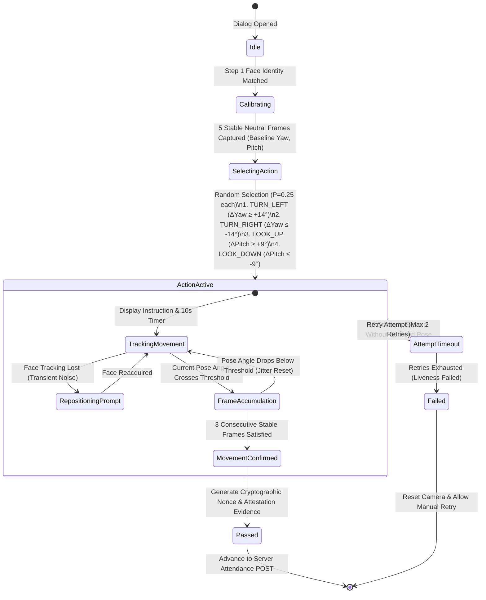
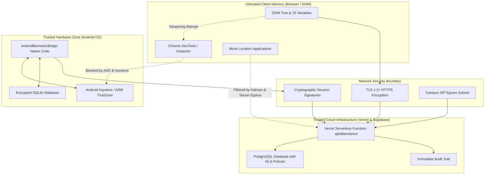

# CampusAttend — System Architecture and Operational Workflows

**Document Version:** 1.0.0 (Production Verified)  
**Project Name:** CampusAttend — Geofenced Biometric Attendance Management System  
**Repository Path:** `D:\project\geo-fenced-attendence-system`  
**Production URL:** `https://geo-fenced-attendence-system.vercel.app/`  
**Classification:** Authoritative Technical Reference  

---

## Table of Contents
1. [High-Level Architectural Overview](#1-high-level-architectural-overview)
2. [End-to-End System Component Architecture](#2-end-to-end-system-component-architecture)
3. [Face Enrollment Workflow (Multi-Angle Local Keystore Encryption)](#3-face-enrollment-workflow)
4. [Face Re-Enrollment & Single-Approval Lifecycle](#4-face-re-enrollment--single-approval-lifecycle)
5. [Live Attendance Verification & 3-Factor Gating](#5-live-attendance-verification--3-factor-gating)
6. [Single-Action Randomized Head Movement State Machine](#6-single-action-randomized-head-movement-state-machine)
7. [Presentation Attack Detection (PAD) Pipeline](#7-presentation-attack-detection-pad-pipeline)
8. [Kalman Filter & Ray-Casting Geofence Pipeline](#8-kalman-filter--ray-casting-geofence-pipeline)
9. [Security, Trust Boundaries & Cryptographic Data Flows](#9-security-trust-boundaries--cryptographic-data-flows)
10. [Production Cloud & Android Native Deployment Architecture](#10-production-cloud--android-native-deployment-architecture)

---

## 1. High-Level Architectural Overview

CampusAttend is an enterprise-grade academic biometric attendance management platform specifically engineered to eliminate identity impersonation (buddy punching), geographic spoofing, and biometric presentation attacks. The system unifies four foundational architectural principles:

1. **Zero-Trust On-Device Biometric Isolation:** Raw facial images, aligned crops, and 512-dimensional floating-point ArcFace biometric feature vectors are never transmitted over the internet or stored on central database servers. Biometric templates are stored exclusively on authorized Android hardware devices, encrypted with hardware-backed AES-256-GCM authenticated encryption through the Android Keystore system.
2. **Deterministic 3-Factor Presence Gating:** Attendance authorization requires concurrent fulfillment of:
   - **Network Verification:** Association with the campus Wi-Fi infrastructure (SSID containing `sona` and verification through campus egress public IPs `111.92.42.18` or `115.247.87.98`).
   - **Geographic Boundary Enforcement:** Device coordinates verified inside a 19-vertex polygon of Sona College of Technology via the Jordan Curve Theorem (Ray-Casting algorithm) smoothed by a 1D Kalman filter.
   - **Biometric & Liveness Verification:** 1:1 ArcFace cosine similarity matching combined with neural presentation attack detection (MiniFASNet-V2) and a randomized single-action head movement challenge.
3. **Hardware Device Binding & Replay Immunity:** Biometric templates and authentication sessions are cryptographically bound to hardware device identifiers (`Settings.Secure.ANDROID_ID`) and single-use cryptographic attempt nonces.
4. **Single-Approval Re-Enrollment Governance:** Staff members cannot arbitrarily change their enrolled face. Re-enrollment requires submission of an administrative ticket, cryptographic approval token minting by an authenticated supervisor, and atomic token consumption in PostgreSQL via `SELECT ... FOR UPDATE` row locks.



---

## 2. End-to-End System Component Architecture

The physical system consists of three distinct processing zones:

### 2.1 Native Android Shell (`com.campusattend.biometric`)
- **Container:** Kotlin-based Android application utilizing an optimized hardware-accelerated `WebView`.
- **Bridge Ingestion:** Injects `AndroidBiometricBridge` via `@JavascriptInterface` into the JavaScript execution runtime (`window.AndroidBiometricBridge`).
- **Hardware Cryptography:** `BiometricKeystoreManager` generates an asymmetric/symmetric master key inside the Android Keystore provider (`AndroidKeyStore`). Key material is permanently isolated inside hardware security modules (ARM TrustZone / StrongBox Keymaster) and cannot be extracted even by rooted devices.
- **Local Storage:** SQLite database encrypted via SQLCipher (`net.zetetic:android-database-sqlcipher:4.5.4`), storing 5 registered template slots per staff member.

### 2.2 Client Web Application (`src/`)
- **Application Engine:** TanStack Start (`@tanstack/react-start`) and TanStack Router running React 19.
- **Biometric Inference Pipeline:** `onnxruntime-web` (WebAssembly with SIMD) executing InsightFace MobileFaceNet (`w600k_mbf.onnx`) and MiniFASNet-V2 (`MiniFASNetV2.onnx`).
- **Vision Preprocessing:** `face-api.js` SSD MobileNet V1 face detection and 68-point landmark tracker.
- **Dynamic Viewport:** Full-screen responsive authentication modal (`FaceScanDialog.tsx`) wrapped in Radix UI `DialogContent` with `fullScreen={true}` and dynamic `100dvh` viewport sizing.

### 2.3 Serverless Compute & Cloud Storage
- **Runtime:** Vercel Serverless Functions running Node.js 24 and Nitro.
- **Database:** Supabase managed PostgreSQL 15 with Row Level Security (RLS) policies and `pgvector` extension.
- **Cryptographic Gatekeepers:** All attendance requests require server verification of client public egress IP addresses and cryptographic session tokens minted with HMAC-SHA256.



---

## 3. Face Enrollment Workflow

Initial enrollment establishes the baseline biometric identity for a registered staff member. To ensure robust recognition across environmental variations without compromising privacy, CampusAttend implements a multi-angle burst enrollment workflow executed entirely on the local device.



---

## 4. Face Re-Enrollment & Single-Approval Lifecycle

To prevent unauthorized template swapping (e.g. an employee attempting to enroll a colleague's face to enable proxy attendance), CampusAttend implements an administrator-supervised re-enrollment lifecycle. Once enrolled, biometric slots are cryptographically locked. Any modification requires an administrative ticket and an atomic cryptographic token consumption process.



---

## 5. Live Attendance Verification & 3-Factor Gating

Attendance marking is governed by a strict sequential pipeline that terminates immediately upon failure of any gate:



---

## 6. Single-Action Randomized Head Movement State Machine

The active liveness challenge enforces human response to a real-time prompt generated with a cryptographic nonce. Nodding and blinking have been completely eliminated. The state machine strictly selects from four orthogonal directional movements:



### Pose Coordinate Conventions & Angle Equations:
1. **Yaw Calculation ($\Delta\text{Yaw}$):**
   $$\text{offset} = \frac{X_{\text{nose\_tip}} - \frac{X_{\text{left\_edge}} + X_{\text{right\_edge}}}{2}}{\frac{|X_{\text{right\_edge}} - X_{\text{left\_edge}}|}{2}}$$
   $$\text{Yaw} = \text{offset} \times 45.0^\circ$$
   - Physical Turn LEFT: Nose shifts toward landmark 16 $\rightarrow \Delta\text{Yaw} \ge +14.0^\circ$.
   - Physical Turn RIGHT: Nose shifts toward landmark 0 $\rightarrow \Delta\text{Yaw} \le -14.0^\circ$.
2. **Pitch Calculation ($\Delta\text{Pitch}$):**
   $$\text{Ratio} = \frac{Y_{\text{nose\_tip}} - Y_{\text{nose\_bridge}}}{Y_{\text{chin}} - Y_{\text{nose\_tip}}}$$
   $$\text{Pitch} = (\text{Ratio} - 0.60) \times 70.0^\circ$$
   - Physical Tilt UP: Upper nose compresses vertically $\rightarrow \Delta\text{Pitch} \ge +9.0^\circ$.
   - Physical Tilt DOWN: Upper nose lengthens $\rightarrow \Delta\text{Pitch} \le -9.0^\circ$.

---

## 7. Presentation Attack Detection (PAD) Pipeline

To counter physical presentation attacks without adding latency, CampusAttend fuses deep neural network inference with multi-spectral optical heuristic analyzers:

```mermaid
flowchart TD
    Frame[Live Camera Video Frame] --> Crop1[128x128 Face ROI Crop]
    Frame --> Crop2[80x80 BGR 2.7x Extended Bounding Box]

    subgraph OpticalAnalyzers["Layer 1: Optical Heuristic Analyzers"]
        Crop1 --> Moire[High-Frequency Moire Energy\nLaplacian Kernel Edge Derivative]
        Crop1 --> Glare[Specular Screen Glare Ratio\nPlanar Glass Luminance > 248]
        Crop1 --> Gamut[Color Gamut Dynamic Range\nRGB Variance & Saturation Histogram]
        Crop1 --> Motion[Temporal Motion Variance\nPixel History Matrix Buffer N=8]
    end

    subgraph NeuralAnalyzer["Layer 2: MiniFASNet-V2 Deep Neural Network"]
        Crop2 --> PlanarTensor[Planar Float32 Array [1, 3, 80, 80]\nRaw BGR Pixels in [0..255] Range]
        PlanarTensor --> WASMInference[onnxruntime-web WASM Session]
        WASMInference --> RawLogits[Raw Output Logits: [1, 3]]
        RawLogits --> Softmax[Softmax Function]
        Softmax --> Classes[Class 0: Print Attack Score\nClass 1: Live Real Face Score\nClass 2: Screen Replay Score]
    end

    subgraph DecisionFusion["Layer 3: Decision Fusion & Risk Weighting"]
        Moire & Glare & Gamut & Motion --> HeuristicScore[Aggregate Optical Risk Score]
        Classes --> NeuralScore[Neural Live Probability]
        HeuristicScore & NeuralScore --> PolicyCheck{Enforce Security Policy:\nLive Score ≥ 70%\nGlare Ratio < 22%\nMoire Energy < 45%\nTemporal Motion Variance ≥ 0.8}
    end

    PolicyCheck -- "Violated" --> RejectSpoof[REJECT: Presentation Attack Detected]
    PolicyCheck -- "Satisfied" --> AcceptLive[PASS: Genuine Human Presentation Verified]
```

---

## 8. Kalman Filter & Ray-Casting Geofence Pipeline

To prevent attendance marking outside campus grounds, raw device coordinates undergo real-time noise reduction before rigorous point-in-polygon boundary evaluation:

```mermaid
flowchart TD
    GPS[HTML5 Geolocation API / Android FusedLocationProviderClient] --> RawCoord[Raw Coordinate: Lat_m, Lng_m, Accuracy_m]
    
    subgraph KalmanFilter["1D Discrete Kalman Filter (Lat & Lng)"]
        RawCoord --> Predict[Time Update: State Prediction & Covariance Extrapolation]
        Predict --> Gain[Compute Kalman Gain: K = P_pred / (P_pred + R)]
        Gain --> Correct[Measurement Update: Estimate = Prev + K * (Measured - Prev)]
        Correct --> UpdateCov[Covariance Update: P = (1 - K) * P_pred]
        UpdateCov --> FilteredCoord[Smoothed Coordinate: Lat_f, Lng_f]
    end

    subgraph GeofenceEvaluator["Ray-Casting Algorithm (Jordan Curve Theorem)"]
        FilteredCoord --> Polygon[19-Vertex Sona College Polygon Boundary]
        Polygon --> RayCast[Cast Horizontal Ray (Y = Lat_f, X > Lng_f)]
        RayCast --> IntersectLoop[Loop Over 19 Polygon Edges C_i -> C_j]
        IntersectLoop --> CrossingCount{Count Ray-Edge Intersections}
        CrossingCount -- "Odd Number of Crossings" --> Inside[Result: INSIDE CAMPUS]
        CrossingCount -- "Even Number of Crossings" --> Outside[Result: OUTSIDE CAMPUS]
    end

    subgraph DistanceCalculators["Haversine Metric Analyzers"]
        FilteredCoord --> CentroidDist[Great-Circle Distance to Campus Centroid: 11.67698, 78.12535]
        FilteredCoord --> BoundaryDist[Perpendicular Distance to Nearest Polygon Edge]
    end

    Inside --> GatingDecision{Accuracy ≤ 50m & Inside == true}
    Outside --> BlockAttendance[Block: Geofence Gate Failed]
    GatingDecision -- "True" --> PermitAttendance[Permit: Geofence Gate Passed]
    GatingDecision -- "False" --> BlockAttendance
```

---

## 9. Security, Trust Boundaries & Cryptographic Data Flows

The following diagram defines the physical and cryptographic boundaries separating client-controlled memory from trusted execution environments:



### Trust Boundary Rules:
1. **Zero Client Trust on Attendance Authorization:** The serverless handler `api/attendance.ts` never trusts boolean flags passed by the client (such as `wifiAuthorized: true` or `geofencePassed: true`). The server independently recalculates the ray-casting algorithm on the submitted GPS coordinates and independently validates the network session token or caller egress IP.
2. **Biometric Data Non-Exfiltration:** Plaintext embeddings and face crops exist solely within volatile memory during inference and are garbage-collected immediately. Persistent templates are locked in hardware-bound ciphertext with Authenticated Additional Data (`$staffId:$deviceId`).
3. **Replay Protection:** Attendance submissions require an `attemptNonce` issued by the liveness engine and validated against recent audit logs to prevent replaying recorded HTTP packets.

---

## 10. Production Cloud & Android Native Deployment Architecture

The following diagram maps the production deployment topology linking Git, Vercel, Supabase, and client mobile devices:

```mermaid
flowchart TD
    subgraph GitRepo["Source Control (GitHub)"]
        MainBranch[Branch: main\nCommit: aa65c83]
        LovableSync[Lovable.dev Bidirectional Sync]
    end

    subgraph VercelCI["Vercel Cloud CI/CD Pipeline"]
        Webhook[GitHub Deployment Webhook]
        ViteBuild[Vite 8.2 + Nitro Build]
        StaticDeploy[Edge CDN: Static Assets, WASM, ONNX Models]
        ServerlessDeploy[Edge Compute: Node.js Serverless Functions]
    end

    subgraph SupabaseCloud["Supabase Managed Database"]
        PostgresInstance[PostgreSQL 15 Instance (AWS ap-south-1)]
        PgVectorInst[pgvector Extension]
        RLSInst[Row Level Security Engine]
    end

    subgraph AndroidBuild["Android Native Packaging"]
        GradleBuild[Android Gradle Plugin 8.2.0 + Kotlin 1.9.22]
        ProGuard[R8 Code Shrinker & Resource Optimizer]
        APK[Compiled APK: app-debug.apk (162 MB)]
    end

    subgraph UserDevices["End-User Client Devices"]
        MobileApp[CampusAttend Native App (WebView Shell)]
        MobileBrowser[Chrome / Safari Web Browser]
    end

    MainBranch --> Webhook
    MainBranch <--> LovableSync
    Webhook --> ViteBuild
    ViteBuild --> StaticDeploy & ServerlessDeploy
    
    ServerlessDeploy <--> PostgresInstance
    PostgresInstance --- PgVectorInst & RLSInst

    MainBranch --> GradleBuild
    GradleBuild --> ProGuard
    ProGuard --> APK
    APK --> MobileApp

    StaticDeploy --> MobileApp & MobileBrowser
    ServerlessDeploy --> MobileApp & MobileBrowser
```
